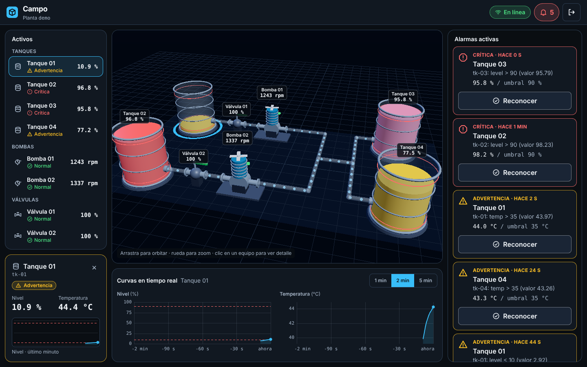
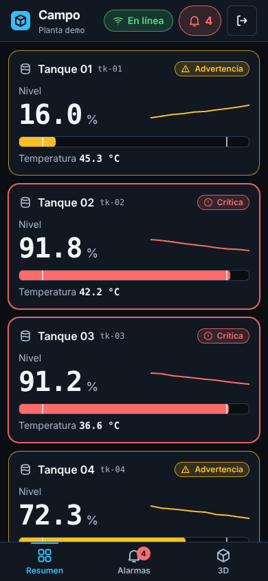

# Campo 2.0

Plataforma SCADA moderno para plantas agroindustriales: gemelo digital 3D en tiempo real, ingesta de baja latencia y una UI móvil pensada para operar desde el campo.

| Escritorio | Móvil |
|---|---|
|  |  |

## Arquitectura

```
sensor ─MQTT→ Mosquitto → ingest (Go) ─┬─ Redis   (estado actual + pub/sub)
                                        └─ TimescaleDB (histórico, por lotes)
                         api (NestJS) ← Redis → alarmas + WebSocket → web (Next.js, R3F, PWA)
```

La ruta caliente (sensor → pantalla) no pasa por la base de datos. Contratos completos en [`docs/architecture.md`](docs/architecture.md).

```
apps/
  ingest/     Go: MQTT → Redis / TimescaleDB, métricas Prometheus, simulador de planta
  api/        NestJS: auth y roles, histórico, motor de alarmas, WebSocket
  web/        Next.js + React Three Fiber + Zustand + Tailwind, PWA
packages/shared/   tipos compartidos (contratos)
infra/             Mosquitto y esquema de TimescaleDB
docs/              arquitectura
```

## Puesta en marcha

Requiere Docker. Todo el stack, con datos simulados:

```bash
cp .env.example .env        # edita JWT_SECRET y ADMIN_PASSWORD
docker compose --profile apps --profile sim up -d --build
```

- Web: <http://localhost:3000> (usuario `ADMIN_EMAIL` / `ADMIN_PASSWORD` del `.env`)
- API: <http://localhost:3001> · métricas de ingesta: <http://localhost:8080/metrics>

Solo infraestructura (TimescaleDB `:5432`, Redis `:6379`, Mosquitto `:1883`), para desarrollar cada app a mano:

```bash
docker compose up -d
```

Cada app tiene su propio README con variables y scripts. La web funciona sola en **modo demo** (sin backend) con `cd apps/web && npm i && npm run dev`.

## Pruebas

```bash
(cd apps/ingest && go vet ./... && go test -race ./...)
(cd apps/api && npm ci && npm run lint && npm test && npm run test:e2e)
(cd apps/web && npm ci && npm run lint && npm test)
```

El CI (`.github/workflows/ci.yml`) ejecuta lo mismo en cada push.

## Estado y límites conocidos

Verificado de punta a punta (simulador → MQTT → ingesta → Redis/Postgres → API → WebSocket → navegador) con servicios locales. **Aún no se ha probado con Docker ni con TimescaleDB real** (las consultas de histórico se probaron sobre Postgres plano): hazlo con el compose antes de confiar en el histórico.

- Ingesta: no escala a varias réplicas con el mismo `MQTT_CLIENT_ID` (haría falta suscripción compartida). Un corte de Postgres de más de ~30 s pierde esa porción del histórico.
- API: el motor de alarmas corre en memoria; con varias réplicas, activarlo en una sola (`ALARM_ENGINE_ENABLED=false` en el resto). No hay autorización por planta. Un usuario desactivado conserva acceso hasta que expira su token.
- Web: el layout 3D está hecho a mano para la planta `demo`. Las variables `NEXT_PUBLIC_*` se fijan en el build.
- Mosquitto está configurado solo para desarrollo (anónimo, sin TLS).

## Siguientes pasos sugeridos

1. Pantallas de administración (activos, reglas de alarma, usuarios) sobre la API ya existente.
2. Comandos hacia los equipos (`campo/v1/{planta}/{activo}/cmd`) con confirmación y auditoría.
3. Autorización por planta y despliegue con TLS/MQTT autenticado.
4. Importación de modelos 3D reales (glTF) por activo (`model3d_ref` ya existe en el catálogo).
